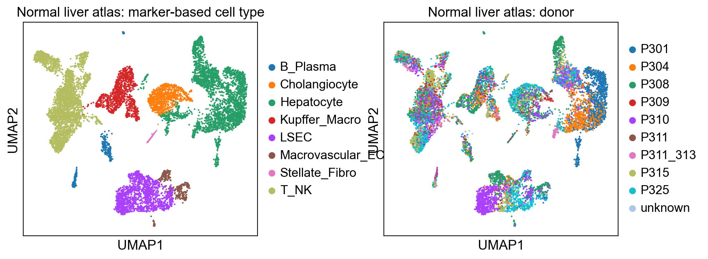
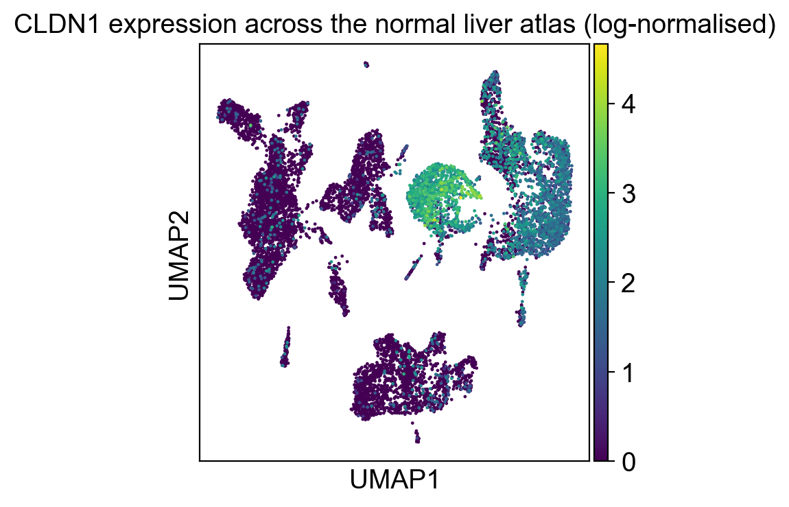

# Claudin-1 (CLDN1) in public human liver data. 

Pearl Saldanha · [github.com/pearlsal](https://github.com/pearlsal)

Reproducible re-analysis scripts for Claudin-1 (CLDN1) in public human liver data: a single-cell RNA-seq atlas of
normal human liver and a bulk NAFLD fibrosis cohort. This repo is mainly for self-learning rather than new or novel analysis

## Data (all public, downloaded by the scripts)
| Dataset | What | Source |
|---|---|---|
| GSE124395 | CEL-seq2 scRNA-seq, normal human liver cell atlas | Aizarani et al., *Nature* 2019 |
| GSE49541 | 72 NAFLD liver biopsies, mild (F0–1) vs advanced (F3–4) fibrosis, Affymetrix HG-U133 Plus 2.0 | Moylan et al., *Hepatology* 2014 |

## Run
```bash
python3 -m venv .venv && source .venv/bin/activate
bash run_all.sh        # Python >= 3.10; peak RAM ~8.5 GB (RData conversion)
```
Dependencies: `env/requirements.txt` (some versions are pinned because newer ones fail to install or crash);
exact environment used: `env/pip_freeze.txt`. Outputs are written to `results/`.

| Step | Script | What it does |
|---|---|---|
| 0 | `scripts/00_download.sh`, `scripts/00b_convert_rdata.py` | download from GEO, checksum, RData → Matrix Market |
| 1 | `scripts/01_atlas.py` | donor mapping from GEO sample records, QC, normalisation, Leiden clustering, UMAP, marker-based annotation, expression of target genes by cell type |
| 2 | `scripts/02_bulk.py` | probe → gene, PCA, independent filtering, differential expression (Welch t-test + Benjamini–Hochberg), Hallmark pre-ranked GSEA |
| 3 | `scripts/03_integrate.py` | atlas-derived cell-type signatures scored in the bulk cohort |
| 4 | `scripts/04_classifier.py` | L1-regularised logistic regression with nested cross-validation and a permutation baseline |

## Normal human liver atlas (GSE124395)
10,356 cells after QC; cell types annotated from canonical marker genes.

| Cell types and donors | CLDN1 expression |
|---|---|
|  |  |

**CLDN1 by cell type** (full table with OCLN, CD81, SCARB1, EGFR, COL1A1, TIMP1 and TGFB1:
[`results/tables/01_target_expression_by_celltype.csv`](results/tables/01_target_expression_by_celltype.csv)).
% = percent of cells with any CLDN1 counts; mean = mean log-normalised expression.

| Cell type | Cells | Donors | CLDN1 % | CLDN1 mean |
|---|---|---|---|---|
| Cholangiocyte | 901 | 9 | 96.1 | 2.476 |
| Hepatocyte | 3,018 | 9 | 65.8 | 1.118 |
| Stellate_Fibro | 39 | 8 | 17.9 | 0.287 |
| Macrovascular_EC | 318 | 6 | 10.1 | 0.140 |
| Kupffer_Macro | 1,087 | 9 | 5.9 | 0.086 |
| B_Plasma | 305 | 9 | 5.6 | 0.081 |
| LSEC | 1,594 | 9 | 5.1 | 0.084 |
| T_NK | 3,094 | 9 | 4.8 | 0.077 |
